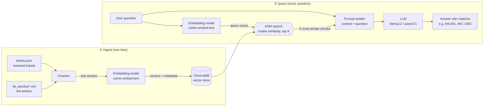

# 🛠️ IT Helpdesk Assistant — RAG Demo

A small, fully local **Retrieval-Augmented Generation (RAG)** demo. It answers IT support questions using past resolved tickets and knowledge-base (KB) articles.

> **Everything runs on your machine.** The embeddings and the LLM both run in [Ollama](https://ollama.com), and the vector database is ChromaDB stored on disk. No API keys, and no data leaves your laptop.

---

## How it works



1. **Chunking.** Each resolved ticket becomes one chunk (problem + resolution). Each KB article is split into one chunk per `##` section, and every chunk keeps its article title. Open tickets are skipped because they have no answer yet.
2. **Embedding.** Every chunk is turned into a 768-dimension vector by `nomic-embed-text`.
3. **Storage.** The vectors, text and metadata (source, category, title) are stored in ChromaDB with cosine distance.
4. **Retrieval (KNN).** The question is embedded with the same model, and Chroma's HNSW index returns the K nearest chunks. Chunks below a minimum similarity are dropped.
5. **Generation.** The remaining chunks and the question go into a prompt that tells the LLM to answer **only** from that context and to cite sources. If nothing relevant is found, the LLM is skipped and the user is told to raise a ticket. This guards against hallucination.

The UI shows every step: the retrieved chunks with their similarity scores, and the exact prompt sent to the LLM.

---

## Quick start (Windows)

**Prerequisites:** Python 3.10+ and [Ollama](https://ollama.com/download).

```powershell
# 1. Get the models (chat model + embedding model)
ollama pull llama3.2
ollama pull nomic-embed-text

# 2. Set up Python
git clone https://github.com/<your-username>/it-helpdesk-rag-demo.git
cd it-helpdesk-rag-demo
python -m venv .venv
.venv\Scripts\activate
pip install -r requirements.txt

# 3. Build the vector index (embeds all tickets + articles, ~10-30 s)
python scripts/ingest.py

# 4. Launch the UI
streamlit run app.py
```

Open http://localhost:8501 and try *"My VPN keeps disconnecting every few minutes"*.

<details>
<summary>macOS / Linux</summary>

```bash
python3 -m venv .venv && source .venv/bin/activate
pip install -r requirements.txt
python scripts/ingest.py
streamlit run app.py
```
</details>

### Command-line check (no UI)
```powershell
python scripts/ask.py "Outlook is stuck on loading profile"
```

### Run the tests (no Ollama needed)
```powershell
pytest -q
```
The tests use a tiny deterministic "fake" embedder, so they check loading, chunking, KNN ordering, filtering and the no-context fallback without any model.

---

## Choosing models

| Role | Default | Alternatives | Notes |
|---|---|---|---|
| Answer LLM | `llama3.2` (3B) | `qwen3.5:9b`, any Ollama chat model | You can switch it from the dropdown in the UI. `qwen3.5:9b` gives better answers but is slower. Its "thinking" mode is turned off automatically. |
| Embeddings | `nomic-embed-text` | `mxbai-embed-large`, `bge-m3` | Set `EMBED_MODEL` in `.env`, then **re-run `ingest.py`**. Query and document vectors must come from the same model. |

All settings live in `.env` (copy `.env.example`): `CHAT_MODEL`, `EMBED_MODEL`, `TOP_K`, `MIN_SIMILARITY`, `TEMPERATURE`, `OLLAMA_URL`.

---

## Project structure

```
it-helpdesk-rag-demo/
├── app.py                     # Streamlit UI
├── data/
│   ├── tickets.json           # 35 synthetic helpdesk tickets (1 open, not indexed)
│   └── kb_articles/           # 12 synthetic KB articles (markdown + front matter)
├── scripts/
│   ├── ingest.py              # build / rebuild the vector index
│   └── ask.py                 # one-shot CLI query
├── src/helpdesk_rag/
│   ├── config.py              # settings (env-overridable)
│   ├── loaders.py             # tickets/articles -> chunks
│   ├── ollama_client.py       # embeddings + streaming chat over Ollama HTTP API
│   ├── vector_store.py        # ChromaDB wrapper + KNN search
│   ├── prompts.py             # system prompt & context formatting
│   └── rag.py                 # the pipeline (ingest / retrieve / ask)
└── tests/test_pipeline.py     # offline tests
```

## Reference data

All data is **synthetic**, created for this demo for a fictional company ("Acme Corp"). It covers VPN, passwords and lockouts, MFA, Outlook, printing, laptops and docks, software requests, Teams, OneDrive and shared drives, Wi-Fi, security incidents (phishing, lost devices, BitLocker) and onboarding.

To use your own data, replace `data/tickets.json` (same fields) and/or drop markdown files into `data/kb_articles/`, then run `python scripts/ingest.py`.

---

## From demo to production: what would change

| Demo | Production consideration |
|---|---|
| Static JSON / markdown files | Connectors to the ITSM tool (e.g. Ivanti, ServiceNow) and the KB (SharePoint, Confluence), with incremental sync |
| Re-index everything | Upserts on ticket close or article update, plus deletion of retired articles |
| Pure vector KNN | **Hybrid search** (BM25 + vectors) and a **re-ranker** to catch exact error codes such as "691" |
| Fixed section chunking | Token-aware chunking with overlap; attachment and screenshot extraction |
| No access control | Filter retrieval by the user's permissions (metadata filters) |
| Manual eyeballing | Evaluation set (question → expected source), with retrieval hit-rate and answer faithfulness tracking |
| Local Ollama | Managed or self-hosted LLM serving, plus logging, PII redaction and feedback buttons |

## License
MIT
